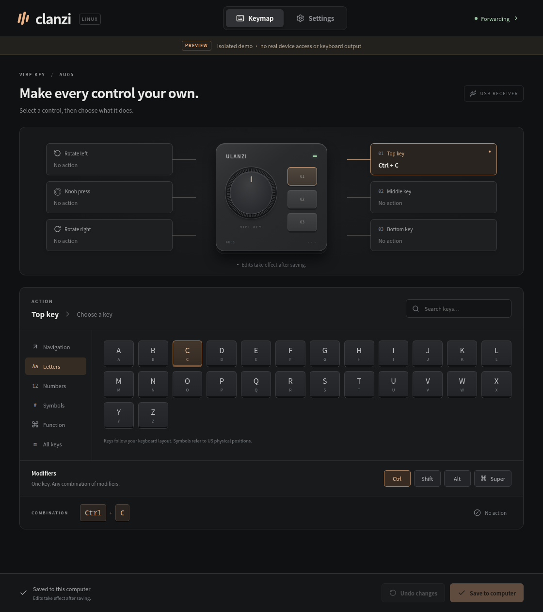

# clanzi

**Turn your Ulanzi Vibe Key into a Linux shortcut controller.**

[中文](README.zh.md) · [Get started](#get-started) · [Configuration](docs/configuration.md) · [Troubleshooting](docs/troubleshooting.md) · [Contribute](CONTRIBUTING.md)

clanzi is an independent, open-source desktop key mapper for the **[Ulanzi Vibe Key (AU05)](https://www.ulanzi.com/products/au05-vibe-key-ai-voice-input-keypad-i018)**. Assign keyboard shortcuts to its three buttons, knob press, and two rotation directions, then keep them running in the background on Linux.

Use it for push-to-talk, editor commands, media keys, or shortcuts in your favorite apps. Built with Rust, Tauri 2, React, and TypeScript; available in English and Simplified Chinese.



*Browser demo of the editor. This preview does not access hardware or send system keys.*

## What you can do

- **Map six controls:** choose a key and combine Ctrl, Shift, Alt, or Super; set unused controls to **No action**.
- **Hold naturally:** buttons and the knob press follow physical press/release. Rotation sends short key taps.
- **Edit before applying:** changes stay in a draft until you save; import and export JSON mappings.
- **Keep shortcuts available:** closing the window leaves forwarding active. Reopen clanzi to edit, pause, or quit.
- **Keep configuration local:** mappings, preferences, and diagnostic logs stay on your computer. clanzi does not listen to ordinary keyboard typing.

clanzi handles keyboard mapping, not voice transcription, firmware updates, lighting, or onboard key tables. It is a community project and is not affiliated with or endorsed by Ulanzi. For the original macOS project and protocol research, see [Olanzi](https://github.com/MrCroxx/olanzi).

clanzi is early-stage software for Linux x86_64. Release packages are built on Ubuntu 22.04. There are no Windows or macOS builds.

## Get started

You need an AU05 with its USB receiver and a local Linux desktop session. Close Ulanzi Studio and other AU05 clients before connecting; use one receiver at a time.

### Install a release

Check [GitHub Releases](https://github.com/JXNCTED/clanzi/releases) for a Linux amd64 `.deb` or `.AppImage` and `SHA256SUMS`. If no packaged release is available, [build from source](#build-from-source).

Download both files into the same directory. From that directory, verify and install them (replace `0.1.0` with the downloaded version):

```sh
sha256sum --check --ignore-missing SHA256SUMS
sudo apt install ./clanzi_0.1.0_amd64.deb
clanzi
```

The package installs device permission rules and enables the uinput module automatically. Reconnect the receiver after installation. Run clanzi as your normal logged-in desktop user.

### Run an AppImage

Download the `.AppImage` and `SHA256SUMS` into the same directory (replace `0.1.0` with the downloaded version):

```sh
sha256sum --check --ignore-missing SHA256SUMS
chmod +x clanzi_0.1.0_amd64.AppImage
./clanzi_0.1.0_amd64.AppImage
```

For real-device use, follow the [one-time AppImage permission setup](docs/troubleshooting.md#appimage-permission-setup). The release includes `70-clanzi.rules` and `clanzi.conf` for this setup. On Ubuntu 22.04, install `libfuse2` if the AppImage reports a missing FUSE library. AppImage users also need the host's `dbus-monitor`, udev, and kmod tools. The GUI always runs as your normal desktop user.

### Make your first mapping

1. Turn on AU05 and open clanzi. In **Settings**, check the receiver and device status; use **Retry connection** if needed.
2. In **Keymap**, select a control, choose a key, and add any modifiers. For a simple first test, assign the top key to `A`.
3. Click **Save to computer**. Editing or importing alone does not change the active mapping. Wait for **Forwarding**; release all controls if synchronization is pending.
4. Focus a blank text editor and press the assigned control. Unassigned controls set to **No action** are ignored while forwarding.
5. Close the window to keep running. Launch clanzi again to reopen it. Use **Settings → Quit clanzi** or the tray menu to exit fully.

You can edit and save without a connected device. Forwarding starts when the device and permissions are ready. **Pause forwarding** attempts to return control to the device; its own mappings may still produce input. For connection or stuck-key problems, see [troubleshooting](docs/troubleshooting.md).

### Push-to-talk with Handy

Set Handy to push-to-talk, assign an AU05 button to the recording shortcut configured in Handy, and save. Hold the button to record; release it to stop. clanzi forwards the shortcut; Handy handles recording and transcription. No long-press mode or threshold is needed.

## Build from source

Install Git, Node.js 24, a current stable Rust toolchain, and the [Tauri Linux prerequisites](https://v2.tauri.app/start/prerequisites/#linux). On Ubuntu:

```sh
sudo apt update
sudo apt install git build-essential pkg-config curl wget file libssl-dev libwebkit2gtk-4.1-dev libayatana-appindicator3-dev librsvg2-dev libxdo-dev libfuse2 patchelf
git clone https://github.com/JXNCTED/clanzi.git
cd clanzi
npm ci
cargo fetch --locked
cargo fetch --manifest-path src-tauri/Cargo.toml --locked
make deb
```

Install `artifacts/clanzi_<version>_amd64.deb` with `sudo apt install`, then follow the first-mapping steps above. `make deb` uses the version in the repository manifests.

Run `make appimage` to build `artifacts/clanzi_<version>_amd64.AppImage` and copy the permission files into `artifacts/`. The first build downloads the Tauri CLI and AppImage bundling tools.

To explore the UI without hardware, run `npm run dev` and open the localhost URL printed by Vite. The browser demo stores data in memory and sends no system keys. For native development, isolated demo mode, checks, and the code map, see [Contributing](CONTRIBUTING.md).

## Update or uninstall

Quit the running instance before updating, then install the newer `.deb` with `sudo apt install ./clanzi_<version>_amd64.deb`. Closing the window is not enough to stop the old instance.

```sh
sudo apt remove clanzi
```

Quit before uninstalling. The package manager removes the packaged permission rules and module-load configuration; your mappings, preferences, and logs remain. See [configuration](docs/configuration.md) for their locations and deletion instructions.

For AppImage updates, quit the old instance and run the new file. To uninstall, delete the AppImage; remove manually installed permission files as described in [troubleshooting](docs/troubleshooting.md#appimage-permission-setup).

## Documentation and support

- [Configuration and input behavior](docs/configuration.md) — save semantics, shared keys, JSON compatibility, and local files.
- [Troubleshooting](docs/troubleshooting.md) — permissions, connection status, synchronization, and recovery.
- [Contributing](CONTRIBUTING.md) — developer setup, checks, and bug-report guidance.
- [Release guide](docs/releases.md) — version alignment, tagging, and packaging workflow.

Report bugs or suggest improvements through [GitHub Issues](https://github.com/JXNCTED/clanzi/issues). English and Chinese reports are welcome.

## Acknowledgments and license

Thanks to **[MrCroxx/olanzi](https://github.com/MrCroxx/olanzi)** and its contributors for the original Olanzi project, AU05 protocol research, documentation, and reference application. Their work made this Linux implementation possible.

clanzi is licensed under the [MIT License](LICENSE). Upstream copyright and license notices are preserved in [THIRD_PARTY_NOTICES.md](THIRD_PARTY_NOTICES.md).
