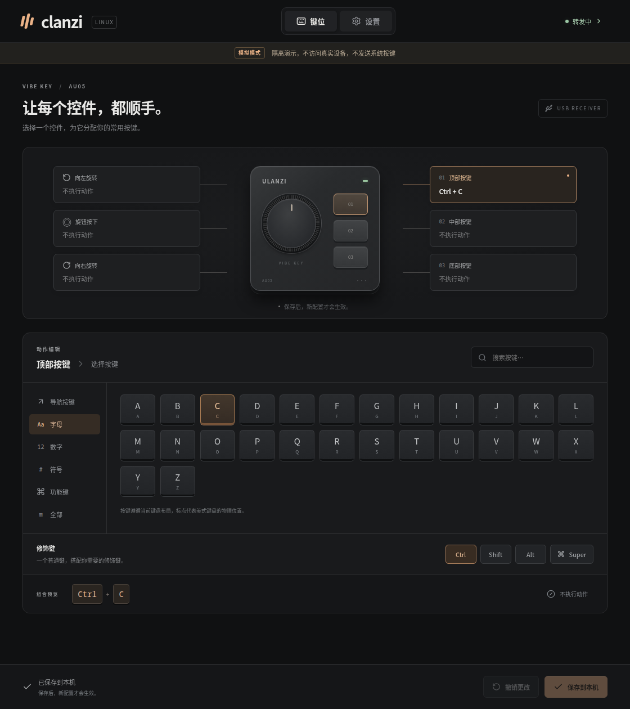

# clanzi

**把 Ulanzi Vibe Key 变成你的 Linux 快捷键控制器。**

[English](README.md) · [快速开始](#快速开始) · [配置说明](docs/configuration.zh.md) · [故障排查](docs/troubleshooting.zh.md) · [参与贡献](CONTRIBUTING.zh.md)

clanzi 是为 **[Ulanzi Vibe Key（AU05）](https://www.ulanzi.com/products/au05-vibe-key-ai-voice-input-keypad-i018)** 开发的独立开源桌面键位映射工具。为三个按钮、旋钮按下和两个旋转方向分配快捷键，在 Linux 后台持续运行。

可用于按住说话、编辑器命令、媒体键，以及常用应用的快捷操作。使用 Rust、Tauri 2、React 和 TypeScript 构建，提供英文与简体中文界面。



*浏览器演示界面，不访问硬件或发送系统按键。*

## 可以做什么

- **映射六个控件：**选择按键，组合 Ctrl、Shift、Alt 或 Super；不需要的控件可设为“不执行动作”。
- **直接跟随按压：**按钮和旋钮按下跟随物理按下／松开，旋转方向发送短按。
- **先编辑，再生效：**修改保留为草稿，保存后才替换当前映射；支持 JSON 配置导入和导出。
- **后台持续使用：**关闭窗口仍会转发，重新打开 clanzi 即可编辑、暂停或退出。
- **配置保存在本机：**映射、偏好和诊断日志留在你的电脑上，不监听普通键盘输入的文本。

clanzi 负责键位映射，不提供语音转写、固件更新、灯光控制或板载键表写入。本项目由社区独立开发，与 Ulanzi 无隶属关系，也未经其背书。原始 macOS 项目与协议研究见 [Olanzi](https://github.com/MrCroxx/olanzi)。

clanzi 是面向 Linux x86_64 的早期软件，发布软件包在 Ubuntu 24.04 上构建。目前没有 Windows 或 macOS 版本。

## 快速开始

需要 AU05、配套 USB 接收器和本地 Linux 桌面会话。连接前退出 Ulanzi Studio 及其他 AU05 客户端，一次只连接一个接收器。

### 安装发布版本

在 [GitHub Releases](https://github.com/JXNCTED/clanzi/releases) 查找 Linux amd64 `.deb` 和 `SHA256SUMS`。若尚无发布软件包，请[从源码构建](#从源码构建)。

将两个文件下载到同一目录，在该目录中校验并安装（把 `0.1.0` 替换为下载的版本）：

```sh
sha256sum --check SHA256SUMS
sudo apt install ./clanzi_0.1.0_amd64.deb
clanzi
```

软件包会自动安装设备权限规则并启用 uinput 模块。安装后重新插拔接收器，以普通的本地登录桌面用户运行 clanzi。

### 设置第一个映射

1. 打开 AU05 电源并启动 clanzi。在**设置**中检查接收器和设备状态，必要时点击**重试连接**。
2. 在**键位**页选择一个控件，再选择按键和修饰键。首次测试可将顶部按键设为 `A`。
3. 点击**保存到本机**。仅编辑或导入不会改变正在运行的映射。等待状态变为**转发中**；若正在同步，请松开所有控件。
4. 聚焦空白文本编辑器，按下刚设置的控件。转发期间，设为**不执行动作**的控件会被忽略。
5. 关闭窗口后仍会后台运行，再次启动 clanzi 可重新打开窗口。通过**设置 → 退出 clanzi**或托盘菜单完全退出。

未连接设备时也可编辑和保存；设备及权限就绪后开始转发。**暂停转发**会尝试交还控制，设备自身的映射仍可能产生输入。连接失败或快捷键卡住时请查看[故障排查](docs/troubleshooting.zh.md)。

### 配合 Handy 按住说话

在 Handy 中启用按住说话，将 AU05 按钮设为 Handy 已配置的录音快捷键并保存。按住录音，松开停止。clanzi 转发快捷键，Handy 负责录音和转写；无需选择长按模式或设置阈值。

## 从源码构建

安装 Git、Node.js 24、当前稳定版 Rust 工具链及 [Tauri Linux 构建依赖](https://v2.tauri.app/start/prerequisites/#linux)。Ubuntu 示例：

```sh
sudo apt update
sudo apt install git build-essential pkg-config curl wget file libssl-dev libwebkit2gtk-4.1-dev libayatana-appindicator3-dev librsvg2-dev libxdo-dev
git clone https://github.com/JXNCTED/clanzi.git
cd clanzi
npm ci
cargo fetch --locked
cargo fetch --manifest-path src-tauri/Cargo.toml --locked
make deb
```

使用 `sudo apt install` 安装 `artifacts/clanzi_<版本>_amd64.deb`，再按上述步骤设置映射。`make deb` 使用仓库清单中的版本号。

无需硬件体验界面：运行 `npm run dev`，打开 Vite 输出的本机网址。浏览器演示仅在内存保存数据，不发送系统按键。原生开发、隔离演示模式、检查命令和代码目录见[贡献指南](CONTRIBUTING.zh.md)。

## 更新与卸载

更新前完全退出旧实例，再通过 `sudo apt install ./clanzi_<版本>_amd64.deb` 安装新软件包。仅关闭窗口不会停止旧实例。

```sh
sudo apt remove clanzi
```

卸载前请退出 clanzi。包管理器会移除随包安装的权限规则和模块加载配置，保留个人映射、偏好及日志。文件位置和删除方法见[配置说明](docs/configuration.zh.md)。

## 文档与支持

- [配置与输入行为](docs/configuration.zh.md)：保存规则、共享按键、JSON 兼容性及本机文件。
- [故障排查](docs/troubleshooting.zh.md)：权限、连接状态、同步与恢复。
- [贡献指南](CONTRIBUTING.zh.md)：开发环境、检查及问题反馈。
- [发布指南](docs/releases.zh.md)：版本对齐、标签和打包流程。

通过 [GitHub Issues](https://github.com/JXNCTED/clanzi/issues) 反馈问题或提出建议，欢迎使用中文或英文。

## 致谢与许可证

感谢 **[MrCroxx/olanzi](https://github.com/MrCroxx/olanzi)** 及其贡献者提供原始 Olanzi 项目、AU05 协议研究、文档和参考应用。这些工作为本 Linux 实现奠定了基础。

clanzi 采用 [MIT 许可证](LICENSE)。上游版权及许可证声明保留在 [THIRD_PARTY_NOTICES.md](THIRD_PARTY_NOTICES.md)。
